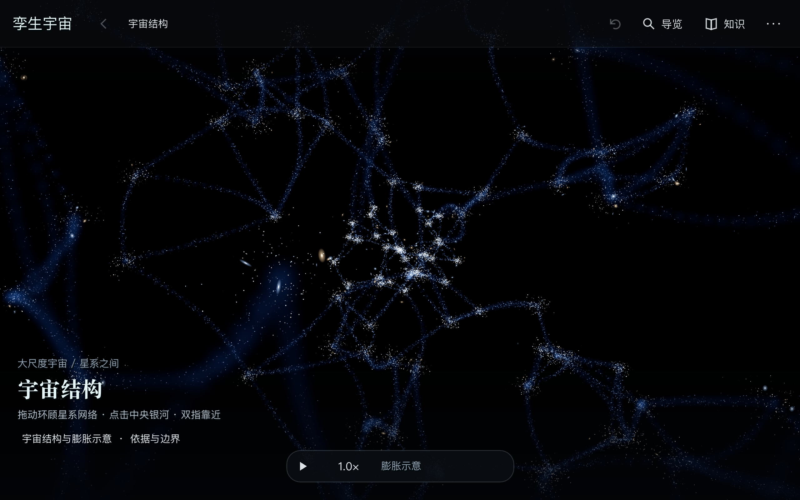

# Twinverse

**Explore the universe and the inner structures of life through interactive 3D scenes.**

[简体中文](README.zh-CN.md) · [Getting started](docs/community/GETTING_STARTED.md) · [Contributing](CONTRIBUTING.md) · [Roadmap](ROADMAP.md) · [Scientific scope](docs/community/SCIENCE.md)

**Built entirely through AI Coding.** Twinverse is developed using Codex, Claude Code and similar coding agents, with the creator directing the work and checking the results. We welcome contributors who use AI to maintain and improve the project. Start with [AGENTS.md](AGENTS.md), the shared project rules, and the [AI collaboration guide](docs/community/AI_COLLABORATION.md); [CLAUDE.md](CLAUDE.md) imports the same rules for Claude Code.



Twinverse is an open-source educational 3D exploration and simulation application. Rotate Earth, approach different habitats, observe celestial motion, or follow a fish into organ, cell and molecular reference views. Developers, artists, educators, scientists and curious explorers are welcome to help improve its accuracy, accessibility and performance.

**Current version: 0.4.189 (build 287).** Representative scenes are playable. Native validation currently focuses on Apple Silicon Macs; Windows and lower-end hardware remain unverified. No public binary release is available yet. The interface supports English and Simplified Chinese. Choose a language or follow the system in the top-right “···” menu; the preference is saved locally.

## Explore

- **Space:** an illustrative cosmic web and Milky Way, the Solar System, the Moon and other natural satellites.
- **Earth:** ocean, woodland, desert, cities and polar environments, with named species and local teaching experiments.
- **The night sky:** reference stars, the Milky Way, Sun, Moon and planets seen from a ground-level observer.
- **Life:** reference views of a fish, heart, cells, mitochondria, molecules and atoms.
- **Spatial interaction:** hover, approach, inspect, enter and return through 3D objects and regions; open explanations when needed.

A comprehensive digital twin is a long-term ambition. The current application combines reference data, simplified models and authored teaching scenes. It does not provide a live reconstruction of the universe. Read the [scientific boundaries](docs/community/SCIENCE.md).

## Run from source

Use the standard **Godot 4.7.2** editor; the exact build is pinned in [.godot-version](.godot-version). Import `project.godot`, wait for the initial resource import, then press **F5** to run the project. macOS helper scripts also require Python 3.11 or newer.

```sh
# From the repository root on macOS; no user save writes.
./tools/godot.sh --headless --editor --quit
./tools/godot.sh -- --no-save --experience-preset --scale=universe
```

For normal save-enabled use, run `./tools/godot.sh`. Set `GODOT_BIN` if the editor is installed elsewhere. Tripo, Blender and generation-service API keys are not required to run existing content. See [development and validation](docs/community/DEVELOPMENT.md) for exact steps and current platform limits.

## Controls and performance

Drag to orbit; pinch or scroll to zoom. Hover for names, click to inspect, and double-click or press Enter to enter supported objects. Backspace returns, R resets the view, Space pauses, and F9 hides the interface. The top-right menu offers Clear, Balanced and Economy quality settings.

The default foreground cap is 30 FPS, with 5 FPS in the background and two shared worker threads. Minimum system requirements have not been certified across devices.

## Contribute

Start with [a bounded first contribution](docs/community/FIRST_CONTRIBUTIONS.md). Science corrections, documentation, translation, art and device reports are welcome alongside code. Read [CONTRIBUTING.md](CONTRIBUTING.md) and the [roadmap](ROADMAP.md).

## Licensing

Project-owned code and written documentation: **[MIT](LICENSE)**. Project-owned and lawfully relicensable generated artwork: **CC BY 4.0**. Third-party media, data and adapted code retain their own terms. See [LICENSING.md](LICENSING.md), [THIRD_PARTY_NOTICES.md](THIRD_PARTY_NOTICES.md) and the [asset inventory](docs/community/ASSET_INVENTORY.json); the root MIT license does not replace those terms.
