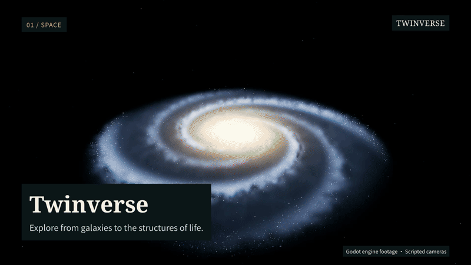

# Twinverse · 孪生宇宙

**从宇宙结构到生命内部，用3D观察理解我们所处的世界。**

[English](README.md) · [开始探索](docs/community/GETTING_STARTED.md) · [参与贡献](CONTRIBUTING.md) · [路线图](ROADMAP.md) · [科学边界](docs/community/SCIENCE.md)

[](https://github.com/chobitsX/Twinverse/releases/tag/v0.4.189-preview.1)

[下载 macOS 体验包](https://github.com/chobitsX/Twinverse/releases/tag/v0.4.189-preview.1) · [54秒中文演示（MP4）](https://github.com/chobitsX/Twinverse/releases/download/v0.4.189-preview.1/twinverse-demo-zh.mp4) · [English demo](https://github.com/chobitsX/Twinverse/releases/download/v0.4.189-preview.1/twinverse-demo-en.mp4) · [静态封面](docs/media/twinverse-poster.jpg)

真实Godot场景，采用程序化运镜与剪辑。[录制方式与署名](docs/media/README.md)。

**本项目完全采用 AI Coding 方式开发。** 我们使用 Codex、Claude Code 等 AI 编程工具完成实现，由发起者提出目标、指导并核查结果，也欢迎其他贡献者用 AI 一起维护和改进项目。先读共享规范 [AGENTS.md](AGENTS.md) 与 [AI 共建指南](docs/community/AI_COLLABORATION.md)；Claude Code 通过 [CLAUDE.md](CLAUDE.md) 读取同一套规则。

Twinverse 是一个以教育科普为主的开源3D宇宙探索与模拟应用。你可以旋转地球、走近不同生态环境，观察天体运动，也可以沿着一条鱼深入器官、细胞与分子层次。我们希望与开发者、美术创作者、教师和科学爱好者一起，让这些体验更准确、更直观，也能在更多电脑上运行。

> 当前版本 **0.4.189（287）**。界面支持简体中文与英文，可从右上角“···”菜单选择语言，支持跟随系统并保存偏好。核心代表场景已可体验；目前实机验证集中在 Apple Silicon Mac。Windows 与低配硬件验证正在路线图中，已有[macOS预览包](https://github.com/chobitsX/Twinverse/releases/tag/v0.4.189-preview.1)（临时签名、未公证）；Intel Mac和其它硬件仍未实测。

## 可以探索什么

| 方向 | 当前体验 |
|---|---|
| 宇宙与天文 | 三维宇宙网、银河、太阳系、月球及其他天然卫星；观察自转、公转和同日期的空间关系 |
| 地球与生态 | 海洋、林地、荒漠、城市、南北极；具名生物、虚拟人物、局部生态教学实验 |
| 地面观星 | 从地球表面观察参考恒星、银河、太阳、月球与行星，比较昼夜和时间变化 |
| 生命内部 | 从鱼类进入心脏、细胞、线粒体、分子与原子的参考结构 |
| 自然探索 | 在3D对象或地域上选择、靠近、进入、返回；按需查看知识、来源与观察主题 |

“孪生宇宙”是长期愿景。当前应用结合真实数据、简化模型和作者设计的教学场景；银河与宇宙网是示意，生态场景也不代表全球实时观测。每类内容的依据与限制见[科学说明](docs/community/SCIENCE.md)。

## 从源码运行

需要固定版本 **Godot 4.7.2**（完整版本见[.godot-version](.godot-version)），使用标准版编辑器；macOS辅助脚本还需要Python 3.11或更新版本。资源已随源码候选提供，首次打开需要Godot导入。

1. 下载或克隆本仓库。
2. 在Godot项目管理器中导入根目录的`project.godot`。
3. 等资源导入完成，按 **F5** 启动整个应用。

macOS也可在仓库根目录运行：

```sh
./tools/godot.sh --headless --editor --quit
./tools/godot.sh -- --no-save --experience-preset --scale=universe
```

该命令默认流畅画质，适合第一次体验，不写入用户存档。需要保存进度时运行`./tools/godot.sh`。编辑器不在默认位置时，通过`GODOT_BIN`指定可执行文件。更完整的步骤、版本检查和故障说明见[开发指南](docs/community/DEVELOPMENT.md)。

无需安装Tripo、Blender或申请生成服务API Key即可运行现有内容；这些工具仅用于资产制作。

## 基本操作

- **拖动**环绕，**双指捏合或滚轮**靠近/拉远。
- **悬停**看名称，**单击**近看；可进入的对象用**双击 / Enter**继续深入。
- **Backspace**或顶部路径返回，**R**恢复视角，**Space**暂停/继续。
- **导览**寻找地区、物种与主题；**知识**查看解释与科学边界。
- **“…” → 画质**选择清晰、流畅或节能；**F9**切换纯净观察。

默认前台30 FPS、后台5 FPS、两条共享工作线程。低开销档位会让远处细节更柔和；当前尚未冻结最低硬件配置。[操作与平台状态](docs/community/GETTING_STARTED.md)

## 一起来建设

不只欢迎代码贡献：科学纠错、使用反馈、翻译、3D素材、教学路线与跨设备测试都很有价值。

- 从[第一份贡献](docs/community/FIRST_CONTRIBUTIONS.md)选择一个范围小、完成标准明确的任务。
- 提问题时使用仓库中的问题反馈、科学纠错或设备测试模板。
- 修改前阅读[贡献指南](CONTRIBUTING.md)，一次提交集中解决一个问题，并注明验证范围。

## 许可与来源

项目自有代码与自有文字说明采用 **[MIT](LICENSE)**。项目有权授权的原创及付费生成美术资源采用 **CC BY 4.0**；第三方图片、数据与派生代码保留各自条款，不能统一视为MIT或公共领域。

查看[许可范围](LICENSING.md)、[第三方署名](THIRD_PARTY_NOTICES.md)和[公开资源清单](docs/community/ASSET_INVENTORY.json)。使用科学机构的资料不表示获得其背书。
